<div align="center">

# ☕ Kaffeekasse

**Self-hosted tally sheet for drinks and snacks – with prepaid balances, a cash box, stock keeping and multiple shops.**
Runs in Docker on your own network – no cloud, no app store.

[Deutsch](README.md) · **English**


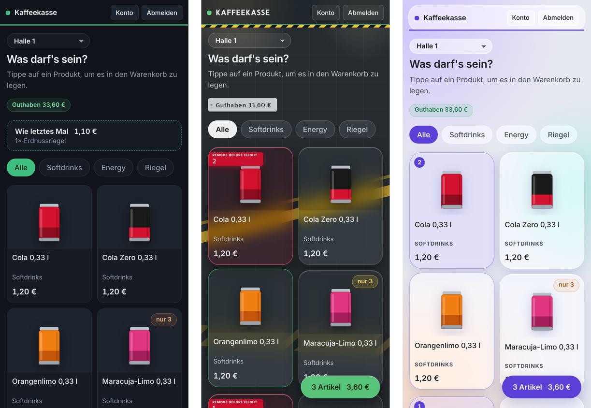

</div>

> **Beta (version 0.x)** – in real use, but still under development. Until 1.0, workflows and settings may still change. Make a backup before every update (see [Updating](#updating)).
>
> **The user interface is in German.** Menu names below are given in German with an English explanation, e.g. *Verwaltung* (administration).

---

## Contents

- [What is it?](#what-is-it)
- [Screenshots](#screenshots)
- [Quick start](#quick-start)
- [Configuration (.env)](#configuration-env)
- [Roles and sign-in](#roles-and-sign-in)
- [Features in detail](#features-in-detail)
- [Designs](#designs)
- [Notifications](#notifications)
- [Backups](#backups)
- [Updating](#updating)
- [Security](#security)
- [Privacy](#privacy)
- [Install as a phone app](#install-as-a-phone-app)
- [Troubleshooting](#troubleshooting)
- [Development and tests](#development-and-tests)
- [License and credits](#license-and-credits)

---

## What is it?

Kaffeekasse (German for "coffee fund") replaces the paper tally sheet on the fridge. Everyone has an account with a prepaid balance, buys on a phone or tablet and tops up the balance in cash with the people in charge. It is built for teams with several locations – for example several halls, each with a fridge and a storeroom.

- **Sign in with a staff number** (8 digits) and a **PIN** to shop – or a **password** for administration. Both go into the same field; the app tells them apart.
- **No self-registration:** only shop managers or administrators create accounts.
- **Multiple shops**, one shared catalogue, stock per shop – split into **fridge** and **storeroom**.
- **Cash box** with cash book, cash audit and printable report.
- **Reporting:** revenue, gross profit, shrinkage, monthly and yearly closing report, order suggestion.
- **Three designs**, light and dark, installable as a phone app.
- **Runs entirely on your network:** fonts, QR codes and images are served locally, nothing talks to third-party services.

Stack: Python 3.12 · Flask · Gunicorn · SQLite · plain HTML/CSS/JavaScript without a build step · two Docker containers (app and backup).

---

## Screenshots

All images show sample data.

### Shopping (phone)

| Sign-in | Shop | Cart |
|:---:|:---:|:---:|
| 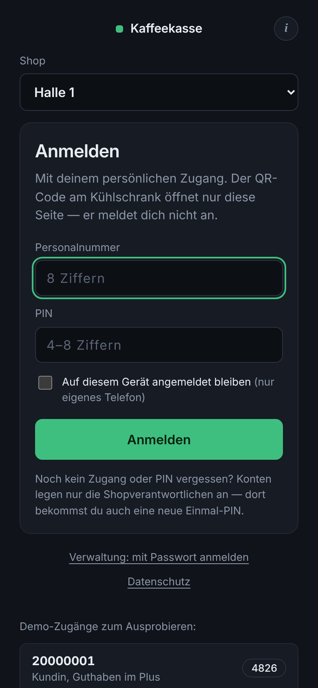 | 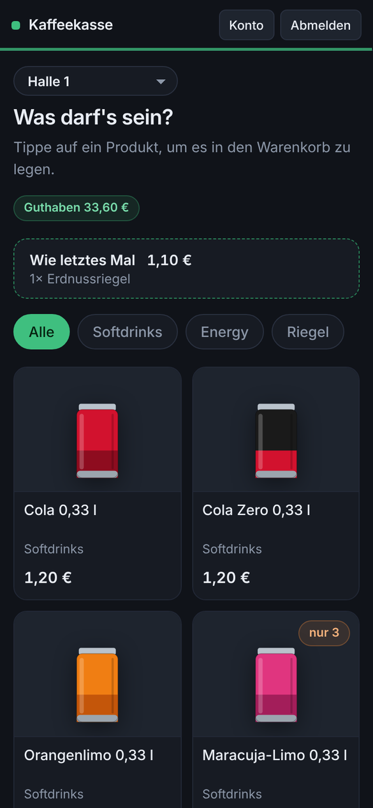 | 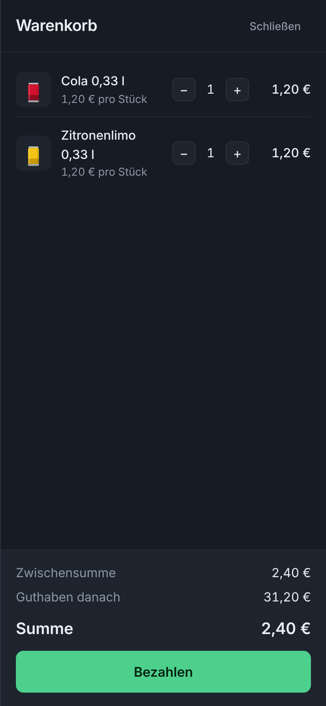 |

### Administration

| Overview | Sales |
|:---:|:---:|
| 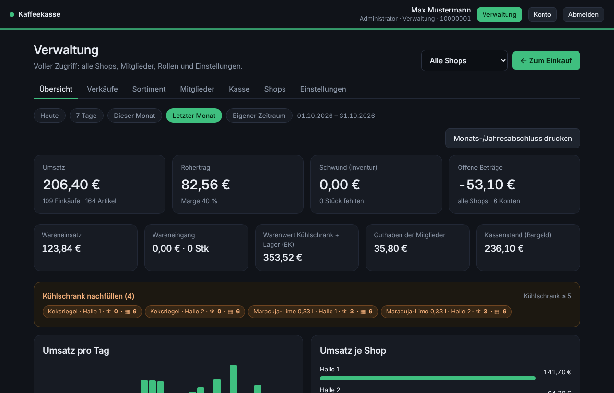 | 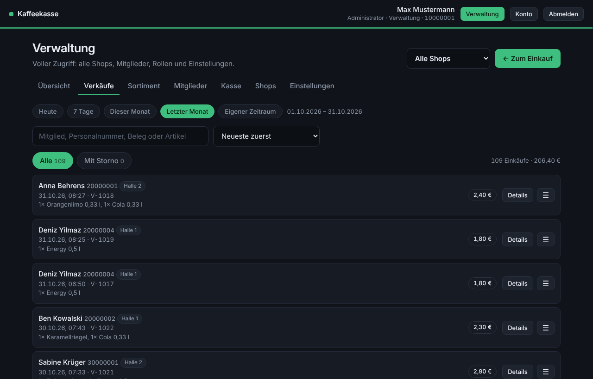 |
| **Assortment** (fridge / storeroom per shop) | **Order suggestion** |
| 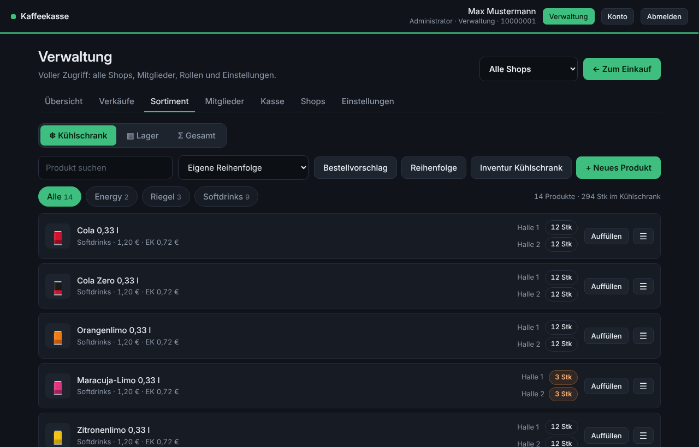 | 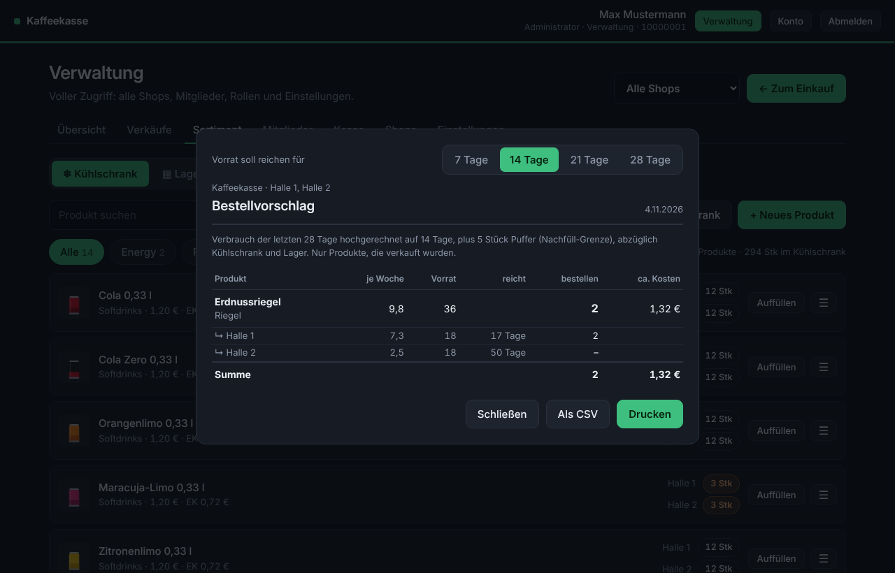 |
| **Members** | **Cash box** |
| 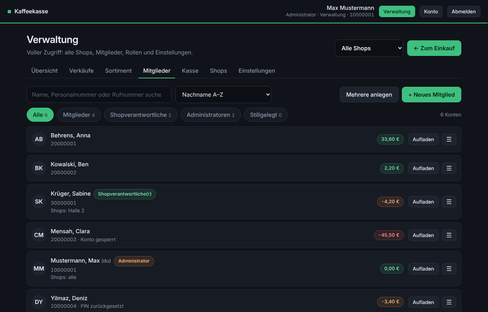 | 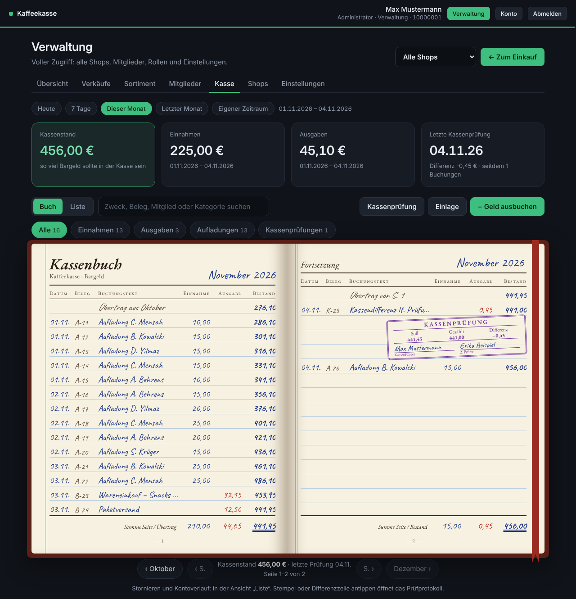 |
| **Monthly report** for printing | **Shops** |
| 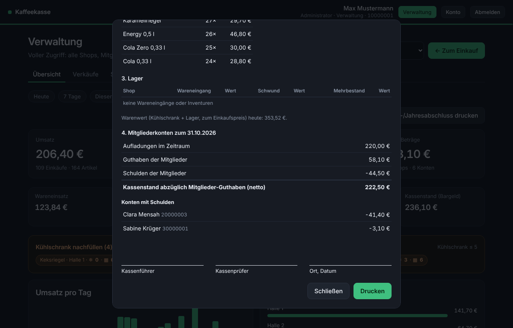 | 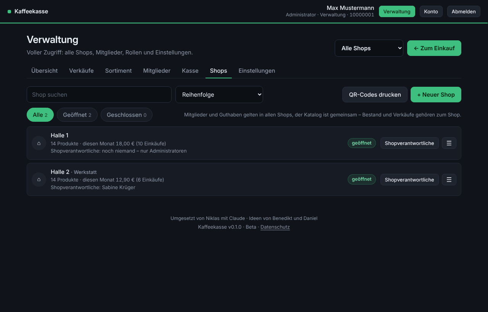 |

---

## Quick start

Requirements: a computer or server with Docker and Docker Compose.

```bash
git clone https://github.com/TWIX99b/kaffeekasse.git
cd kaffeekasse
cp .env.example .env        # enter your personal settings
nano .env
docker compose up -d --build
```

Then open `http://<server-ip>:8080` in a browser.

**First-time setup:** On the very first visit the page **Einrichtung** (setup) appears. Enter the name of the Kaffeekasse and of the first shop (e.g. "Halle 1") and create the **administrator**: first name, last name, staff number, password (administration) and PIN (shopping). This works exactly once – there is no default login.
A sample catalogue is already in place, all stock levels are 0. Real goods are added via **Wareneingang** (goods receipt) or **Inventur** (stocktake).

> If the Kaffeekasse is reachable on the network before you have set it up, set `EINRICHTUNGS_CODE` in `.env`. Otherwise someone else could register as administrator first.

**Just trying it out?** Put `DEMO=true` into `.env` before the first start: you get sample accounts and demo buttons on the sign-in page. Keep it at `false` for real use.

**Prebuilt image instead of building yourself:** set `KAFFEEKASSE_IMAGE=ghcr.io/TWIX99b/kaffeekasse` in `.env`, then run `docker compose pull && docker compose up -d`. Images are available for `amd64` and `arm64` (e.g. Raspberry Pi).

---

## Configuration (.env)

All personal values live in `.env` (template: `.env.example`), not in `docker-compose.yml`. The `.env` stays on your server and is never committed – so updates overwrite nothing.
Values marked "initial" only apply on the first start; afterwards they are changed in the app under **Einstellungen** (settings).

| Variable | Default | Meaning |
|---|---|---|
| `PORT` | `8080` | Port on the server |
| `ADRESSE` | `http://kaffeekasse.lokal:8080` | Address printed on access slips and QR codes (initial) |
| `PROXY_ANZAHL` | `0` | Number of reverse proxies in front (Nginx Proxy Manager, Traefik, Caddy …). Behind a proxy: `1` |
| `EINRICHTUNGS_CODE` | empty | Code required for the first-time setup |
| `SHOP_NAME` | `Kaffeekasse` | Name of the Kaffeekasse (initial) |
| `ERSTER_SHOP` | `Halle 1` | Name of the first shop |
| `LIMIT_EUR` | `30` | Debt limit: below this negative balance no purchases are possible (initial) |
| `MIN_BESTAND` | `5` | Refill threshold in the fridge (initial) |
| `WARN_GUTHABEN_EUR` | `5` | Low-balance notice in the shop below this amount, `0` = off (initial) |
| `DATENSCHUTZ_KONTAKT` | empty | Contact person shown in the privacy notice (initial) |
| `STIL` | `standard` | Design: `standard`, `hangar` or `dashboard` (initial) |
| `AUTO_LOGOUT_SECONDS` | `300` | Automatic sign-out while shopping (initial) |
| `AUTO_LOGOUT_TEAM_SECONDS` | `900` | Automatic sign-out in administration (initial) |
| `MAX_BUCHUNG_EUR` | `500` | Largest single top-up, deduction or starting balance |
| `LOGIN_SPERRE_IP` | `30` | Failed sign-ins per IP within 15 minutes before a 15-minute pause (`0` = off) |
| `COOKIE_SECURE` | `auto` | `auto` = secure cookie only over HTTPS |
| `DEMO` | `false` | Sample accounts and demo buttons (before the first start only) |
| `BACKUP_UHR` / `BACKUP_TAGE` | `03:00` / `14` | In-app backups (`0` = off) |
| `SICHERUNG_ORDNER` | `./sicherungen` | Target folder of the backup container, e.g. a NAS |
| `SICHERUNG_UHR` | `02:30` | Times of the automatic backup, comma-separated |
| `SICHERUNG_ANZAHL` | `30` | Number of automatic backups to keep |
| `SICHERUNG_MELDE_URL` | empty | ntfy/Gotify address – reports backup failures only |
| `KAFFEEKASSE_IMAGE` / `KAFFEEKASSE_TAG` | local / `latest` | Image from GitHub and the desired version (see [Updating](#updating)) |
| `TZ` | `Europe/Berlin` | Time zone |

Rarely needed, set directly in `docker-compose.yml`: `COOKIE_NAME` (name of the session cookie, default `kaffeekasse_sitzung`) and `SECRET_KEY` (otherwise a key is generated and stored in `/data/.secret_key`).

---

## Roles and sign-in

| Role (UI name) | With PIN | With password |
|---|---|---|
| **Member** (*Mitglied*) | shop in every shop, view account history, change PIN, choose light/dark | – |
| **Shop manager** (*Shopverantwortliche/r*) | shop like a member | members and balances (all), plus for the **assigned shops**: overview, sales and cancellations, goods receipt, stocktake, create and edit products, order suggestion, closing report, export, log |
| **Administrator** | shop | everything in all shops, plus delete products, create shops, assign shop managers, change roles, settings, notifications, download and restore backups, reset everything |

- **PIN** (4–8 digits) = shopping. **Password** (at least 10 characters, shop managers and administrators only) = shopping and administration.
- After every sign-in the **shop comes first**. With a password, the **Verwaltung** button opens administration, **← Zum Einkauf** returns to the shop.
- New accounts receive a **one-time PIN** (or one-time password) which must be replaced by their own within 10 minutes of the first sign-in.

---

## Features in detail

### Shopping

- **Choose the shop** at the very top – the device remembers it, so a tablet in hall 2 stays on hall 2. The QR code on the fridge opens the right shop directly.
- Tap products, check the **cart**, **pay**. Empty products stay visible but greyed out; low stock shows "only 3 left".
- **Same as last time** (*Wie letztes Mal*): the last purchase in this shop is shown above the products. One tap puts it into the cart – just press pay. Items currently out of stock are skipped.
- **Low-balance notice** (configurable), a warning when in the red, and a block at the **debt limit**.
- After paying: **continue shopping** or **close** (closes the app; the session stays until the automatic sign-out).

### Multiple shops

- **One shared catalogue:** every product exists once – with name, price and picture for all shops.
- **Stock and sales per shop.** In the assortment you decide whether a shop **carries** a product.
- **Members, balances and PINs are valid everywhere.**
- The **administrator** creates shops (optionally with the assortment of another shop, stock starts at 0), closes and deletes them (only while nothing has been sold there) and assigns **shop managers**.
- **Printable QR codes:** *Shops → QR-Codes drucken* creates a notice per shop (about A6, four per A4 sheet, with cut lines). QR codes are generated locally.
- In administration, the selector at the top right chooses the shop for overview, sales, assortment and export – a single shop or all shops.

### Administration

All lists work the same way: **search**, **sort** and **+ new** at the top, **filters** with counts below. Each row has **one main action** and a **☰ menu** with everything else. Overview, sales, cash box, export and log have a **period bar**: today · 7 days · this month · last month · custom range.

**Overview** – revenue, gross profit with margin, shrinkage from stocktakes, outstanding debts, cost of goods, goods received, stock value, member balances, cash on hand. Plus "refill the fridge" (one click opens refill or goods receipt), revenue per day, per shop, best sellers and by category.

**Monthly and yearly closing report** (button in the overview) – a printable report with the cash box (opening and closing balance, all movements, cash audits), sales per shop with cancellations and gross profit, best sellers, goods received and shrinkage, and **member balances and debts as of the closing date** including a list of accounts in debt. Signature fields for the treasurer and auditor at the bottom.

**Sales** – all purchases in the period. **Cancel** single items or whole purchases: the money goes back to the account, the goods back into the shop's fridge. Count and total are computed by the server over all purchases in the period; the newest 2000 are listed.

**Assortment** – the catalogue with stock per shop, split into **❄ fridge** (sold from here) and **▦ storeroom**.
- **Flow:** new goods → **goods receipt** (usually into the storeroom, with purchase price per unit) → **refill** (storeroom → fridge) → sales and cancellations use the fridge. Need room in the fridge? ☰ → **Ins Lager zurücklegen** (fridge → storeroom).
- **Stocktake** separately for fridge and storeroom; differences are booked as shrinkage or surplus.
- **Order suggestion:** projects consumption of the last 28 days onto the next 7/14/21/28 days, adds the refill threshold as a buffer and subtracts fridge and storeroom. Per shop and in total, with estimated cost; print or CSV.
- **Custom order per shop** (drag or ↑/↓), matching how products sit in the fridge.
- Goods receipts, refills, returns to the storeroom and stocktakes are recorded in the **stock ledger** (☰ → Lagerbewegungen); sales and cancellations are listed under **sales**.
- Products are shown as a drawn can or bar; an uploaded photo replaces the drawing (PNG/WebP keep their transparency).

**Members** – all accounts with last name, first name, staff number, internal phone extension and balance. Main action **top up**; the ☰ menu offers deduct, account history, edit account (including PIN/password reset), change role, assigned shops, deactivate, delete.
- **Bulk create:** fill in a table, paste straight from Excel or load a CSV (up to 500 at once). Errors are highlighted immediately; nothing is created until everything is valid. Then print access slips with the one-time PINs.
- **Deactivate** (e.g. when someone is transferred): the account can no longer sign in but keeps staff number, PIN, balance and history. A remaining balance can be paid out in cash at the same time. "Reactivate" makes it usable again.
- **Delete:** purchases and bookings are kept for accounting, a remaining balance is written off, the staff number becomes free.

**Cash box** (cash, one shared box for all shops)
- **Cash on hand** – how much cash should be in the box. **Cash book** with the running balance after every booking – either as a **book** (ruled paper, handwriting, carry-over per page, audit stamps, one page at a time on phones) or as a **list** with search, sorting and reversal.
- **Every top-up is cash** and increases the cash on hand. When deducting, a checkbox decides whether cash was paid out or it is just a correction.
- **Pay out** (purchase of goods, shipping, events …) with purpose and receipt number, **deposit** for money that is not a balance (donation, opening balance).
- An administrator reverses wrong bookings with a counter-entry – nothing is ever deleted from the cash book.
- **Cash audit** with a counting aid (€500 … 1 ct), second auditor and remarks. The difference can be booked so the cash on hand matches again. Every audit produces a printable **record**.

**Settings** (administrator)
- *General:* name, debt limit, automatic sign-out, refill threshold, address for access slips, low-balance notice, **design**, privacy contact.
- *Notifications:* webhook for "refill the fridge".
- *Export:* CSV files for sales (with purchase price and gross profit), cash book, account bookings, stock ledger, stock with value, balances, log. Exports are protected against Excel formulas ("CSV injection").
- *Backup & data:* backups on the server, download, restore, database overview, reset everything.
- *Log:* every change with name and time; cannot be deleted from the app.

---

## Designs

The administrator picks the look for all devices under **Einstellungen → Allgemein → Design der Kaffeekasse** – with an instant preview. Light or dark is chosen by each person under **Konto → Design** (automatic or fixed).

| Standard | Hangar | Dashboard |
|:---:|:---:|:---:|
|  | 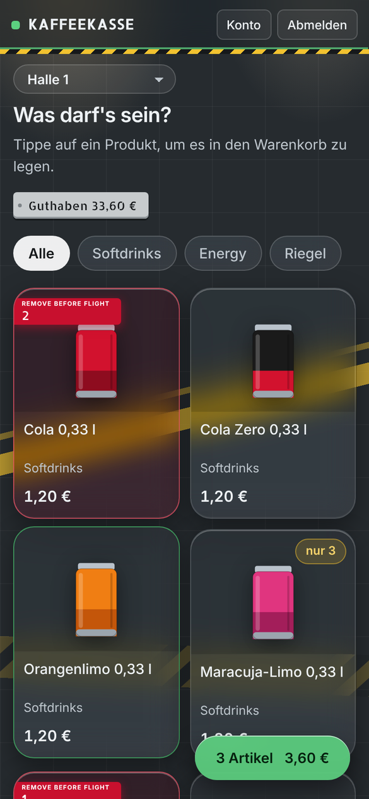 | 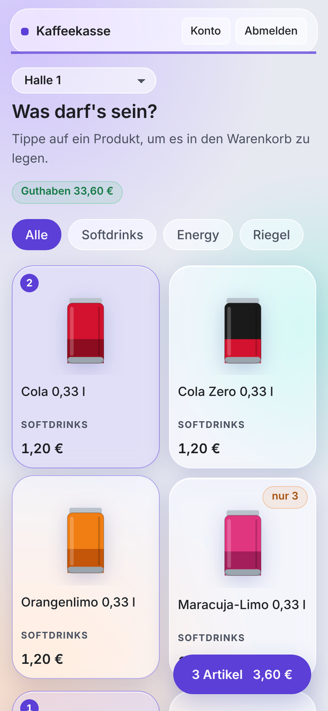 |
| clean, light or dark | hangar floor with markings, glass panels and hazard stripes; balance on a rivet plate, items in the cart carry a **Remove Before Flight** tag. Always dark. | frosted-glass tiles in the style of a Home Assistant dashboard, light or dark |

Printouts (closing report, cash audit, order suggestion, access slips, QR codes) are always black on white, regardless of the design.

More designs can be added: register them in `STILE` in `app.py` and add a `[data-stil="…"]` block to `static/app.css` – the existing ones serve as templates.

---

## Notifications

When a product in a fridge drops to the refill threshold, **one** message is sent (the next one only after a refill). It also mentions the storeroom level ("storeroom empty, please reorder"). There is deliberately no e-mail; instead a **webhook** (*Einstellungen → Benachrichtigungen*):

| Format | Example address |
|---|---|
| Text (ntfy) | `https://ntfy.sh/my-secret-topic` – push to your phone with the ntfy app |
| Gotify | `http://<gotify-server>:<port>/message?token=<app-token>` (token from **Apps → Create Application**, not the client token) |
| JSON (Home Assistant) | `http://homeassistant.local:8123/api/webhook/kaffeekasse` – payload `{"titel", "text", "shop", "produkte": [{"name", "bestand", "lager"}]}` |

**Send test message** shows immediately whether it arrives, or the exact reason why not. Note: `localhost` inside the container is the Kaffeekasse itself – use the server's IP address for other services.

---

## Backups

There are two independent mechanisms.

**1. Backup container** (`sicherung`, recommended) – copies the complete database including product photos into **its own folder outside the data volume**, e.g. on a NAS (`SICHERUNG_ORDNER`).
- Automatically at the times in `SICHERUNG_UHR`; the latest `SICHERUNG_ANZAHL` are kept. Manual backups and those taken before a restore are kept as well.
- Every backup is a true snapshot (SQLite backup API), checked for corruption and stored compressed. The Kaffeekasse keeps running meanwhile.
- Optionally `SICHERUNG_MELDE_URL` (ntfy/Gotify) reports failures.

```bash
docker compose exec sicherung sicherung jetzt "before update"   # back up now, with a note
docker compose exec sicherung sicherung liste                   # list backups
docker compose exec sicherung sicherung pruefen                 # verify the newest (or a given file)
docker compose exec -it sicherung sicherung einspielen kaffeekasse_2026-11-04_023000_auto.db.gz
```

**Restoring** (*einspielen*) first shows what the backup contains and what the database holds now, then asks for confirmation (type `EINSPIELEN`, or pass `--ja` in scripts). The current state is backed up automatically first. Afterwards all devices sign in again. The app does not need to be stopped. A `.db.gz` file is a plain SQLite database after `gunzip`.

**2. In-app backups** – a daily JSON backup at `BACKUP_UHR` inside the data volume, downloadable under *Einstellungen → Sicherung & Daten* and restorable by an administrator. The current state is also backed up before every restore and reset. Backups contain the PIN and password hashes and are therefore available to administrators only.

---

## Updating

**With the image from GitHub:**

```bash
docker compose exec sicherung sicherung jetzt "before update"
docker compose pull
docker compose up -d
```

**From source** (after `git pull`): `docker compose up -d --build`.

Data in the volume is preserved; necessary database migrations run automatically on start. The running version is shown in the footer. Important: do not rename the **project folder** – Docker names the data volume after it.

`KAFFEEKASSE_TAG` in `.env` decides what `docker compose pull` fetches:

| Tag | Meaning |
|---|---|
| `latest` | newest released version (default) |
| `v0.3` | stays on 0.3 and only receives bug fixes (0.3.1, 0.3.2 …) |
| `v0.3.1` | exactly this version |
| `beta` | newest beta including pre-releases for testing (e.g. `v0.4.0-rc.1`) |

Versions below 1.0 are **beta**. Older installations are migrated automatically on start: products with the same name in several shops are merged into one catalogue product, existing stock counts as fridge stock, and very old installations without shops end up in the first shop.

---

## Security

- **PINs and passwords** are stored as hashes only. One-time PINs and passwords are shown exactly once. Weak PINs such as 1111 or 1234 are rejected.
- **Sign-in protection:** 15-minute account lock after 5 failed attempts, plus an IP throttle (`LOGIN_SPERRE_IP`). Responses do not reveal whether a staff number exists.
- **Sessions live on the server:** sign-out, time-out, PIN/password change, role change, deactivation and deletion end the session immediately – on other devices too.
- **Four-eyes principle:** shop managers cannot top up or deduct their own balance. Single bookings are capped at `MAX_BUCHUNG_EUR`. Everything is logged with the person's name.
- **The server checks** prices, stock, permissions and the debt limit – not the browser. Amounts are calculated exactly in cents; more than two decimal places are rejected.
- **Automatic sign-out:** shopping after 5 minutes, administration after 15 minutes. "Stay signed in" applies to shopping only, for at most 30 days.
- **Browser protection:** Content Security Policy (own scripts and fonts only), CSRF protection, HttpOnly and SameSite cookies, no framing by other sites, HSTS over HTTPS.
- **Product photos:** every photo is checked and re-encoded on the server (JPG/PNG/WebP only, at most 1024 px, metadata such as GPS stripped, pixel bombs rejected). It is served only as an image inside a sandbox – photos from imported backups go through the same check.
- The container runs **without root privileges**.

**Recommendations for operation**

1. Set `EINRICHTUNGS_CODE` if the Kaffeekasse is reachable before setup.
2. **Do not expose it directly to the internet** – preferably internal network or VPN only. If you must: only behind a reverse proxy with HTTPS, **redirect HTTP to HTTPS** there (e.g. "Force SSL" in Nginx Proxy Manager) and set `PROXY_ANZAHL=1` in `.env`. Only then does the sign-in protection see real IP addresses and the app recognise HTTPS.
3. Publish the port to the proxy only (e.g. `"127.0.0.1:8080:8080"` in `docker-compose.yml`).
4. Put the backup folder on a different device (NAS).

---

## Privacy

A **privacy notice** is linked on the sign-in page, in the footer of every page and under **Konto** (account): which data is stored, who can see it, for how long and whom to contact. The administrator enters the contact person under *Einstellungen → Allgemein*.

Only data needed for accounting is stored. There is no advertising, no sharing and no connection to third-party services. The text is a template – for business or official use, please review it with your data protection officer.

---

## Install as a phone app

On the sign-in page, the **ⓘ button** explains how to save the Kaffeekasse on a phone – tailored to the device. Over **HTTPS** it can be installed as a proper app (iPhone: Share → "Add to Home Screen", Android/Chrome: "Install app") and then starts without the browser bar, directly in the chosen shop. Over plain HTTP this is not possible – a browser restriction.

The layout fits screens from 320 px wide without zooming.

---

## Troubleshooting

| Problem | Solution |
|---|---|
| "Sitzung abgelaufen – bitte Seite neu laden" right at sign-in | Another app on the same server sets a cookie with the same name. Choose a different name with `COOKIE_NAME`. |
| "Bitte neu anmelden" right after signing in | The browser drops the cookie (e.g. a secure cookie over HTTP). The app also sends the session in the `X-Sitzung` header; behind a proxy set `PROXY_ANZAHL=1`. |
| Locked after 5 failed attempts | Wait 15 minutes or have a shop manager reset the PIN. |
| Notification does not arrive | "Send test message" shows the exact reason. `localhost` inside the container is the Kaffeekasse itself. |
| Backup folder not writable | On the server: `sudo chown -R 1000:1000 <folder>` (the container runs as user 1000). |
| Old view after an update | The page loads new versions automatically; reload once if needed. |

---

## Development and tests

```
kaffeekasse/
├── app.py                  server (Flask): API, database, calculations
├── qr.py                   QR code generation without external services
├── static/                 frontend: index.html, app.js, app.css, fonts, icons
├── sicherung/              second container: backup service
├── tests/                  calculation, image and backup tests
├── docs/screenshots/       images for this README
├── .github/workflows/      tests and image build on GitHub
├── docker-compose.yml      both containers
└── .env.example            template for personal settings
```

Run locally without Docker (Python 3.12):

```bash
pip install -r requirements.txt
DATA_DIR=./data DEMO=true python app.py      # http://localhost:8080
```

**Tests** – they only need Flask and use their own empty database:

```bash
python3 tests/rechentest.py .      # purchases, cancellations, cash box, audit, stocktake, closing report, deactivation … and re-check every total
python3 tests/sicherungstest.py .  # write a backup while purchases keep coming in
python3 tests/bildtest.py .        # malicious files as product photos (disguised HTML, pixel bomb, tampered backup)
```

On GitHub the calculation test runs before every image build (`.github/workflows/images.yml`); if it fails, no image is published. A push to `main` builds the image `main`; a tag such as `v0.2.0` builds `v0.2.0`, `v0.2` and `latest`.

---

## License and credits

**License:** [MIT](LICENSE) – use, modify and share freely as long as the license notice is kept. No warranty: this is a hobby project, no liability for errors in amounts.

Bundled fonts: **Inter** (The Inter Project Authors), **Allerta Stencil** (Matt McInerney), **Caveat** (The Caveat Project Authors) and **EB Garamond** (The EB Garamond Project Authors), all under the SIL Open Font License 1.1 – license texts in `static/fonts`.

Built by **Niklas** with **Claude** · ideas by **Benedikt** and **Daniel**.
