<div align="center">

# ☕ Kaffeekasse

**Selbst gehostete Strichliste für Getränke und Snacks – mit Guthaben, Bargeldkasse, Lager und mehreren Shops.**
Läuft im Docker-Container im eigenen Netz, ohne Cloud, ohne App-Store.

**Deutsch** · [English](README.en.md)


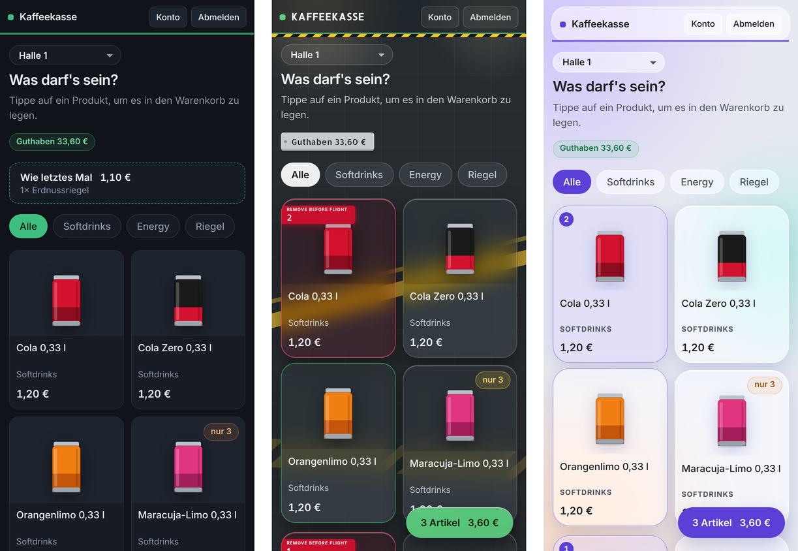

</div>

> **Beta (Version 0.x)** – im echten Einsatz, aber noch in Entwicklung. Bis Version 1.0 können sich Bedienung und Einstellungen noch ändern. Vor jedem Update eine Sicherung machen (siehe [Update](#update)).

---

## Inhalt

- [Was ist das?](#was-ist-das)
- [Screenshots](#screenshots)
- [Schnellstart](#schnellstart)
- [Konfiguration (.env)](#konfiguration-env)
- [Rollen und Anmeldung](#rollen-und-anmeldung)
- [Funktionen im Einzelnen](#funktionen-im-einzelnen)
- [Designs](#designs)
- [Benachrichtigungen](#benachrichtigungen)
- [Sicherungen](#sicherungen)
- [Update](#update)
- [Sicherheit](#sicherheit)
- [Datenschutz](#datenschutz)
- [Als App aufs Handy](#als-app-aufs-handy)
- [Fehlerbehebung](#fehlerbehebung)
- [Entwicklung und Tests](#entwicklung-und-tests)
- [Lizenz und Danksagung](#lizenz-und-danksagung)

---

## Was ist das?

Die Kaffeekasse ersetzt die Strichliste auf Papier am Kühlschrank. Jede Person hat ein Konto mit Guthaben, kauft am Handy oder Tablet ein und zahlt Guthaben bar bei den Verantwortlichen ein. Gebaut für Teams mit mehreren Standorten – zum Beispiel mehrere Hallen mit je einem Kühlschrank und einem Lagerraum.

- **Anmelden mit Personalnummer** (8 Ziffern) und **PIN** zum Einkaufen – oder **Passwort** für die Verwaltung. Beides kommt ins selbe Feld, die App erkennt es selbst.
- **Keine Selbstregistrierung:** Konten legen nur Shopverantwortliche oder Administratoren an.
- **Mehrere Shops**, ein gemeinsamer Katalog, Bestand je Shop – getrennt nach **Kühlschrank** und **Lager**.
- **Bargeldkasse** mit Kassenbuch, Kassenprüfung und Protokoll zum Ausdrucken.
- **Auswertung**: Umsatz, Rohertrag, Schwund, Monats- und Jahresabschluss, Bestellvorschlag.
- **Drei Designs**, hell und dunkel, als App aufs Handy speicherbar.
- **Läuft komplett im eigenen Netz:** Schriften, QR-Codes und Bilder kommen vom eigenen Server, es gibt keine Verbindung zu fremden Diensten.

Technik: Python 3.12 · Flask · Gunicorn · SQLite · reines HTML/CSS/JavaScript ohne Build-Schritt · zwei Docker-Container (App und Sicherung).

---

## Screenshots

Alle Bilder zeigen Beispieldaten.

### Einkaufen (Handy)

| Anmeldung | Einkauf | Warenkorb |
|:---:|:---:|:---:|
| 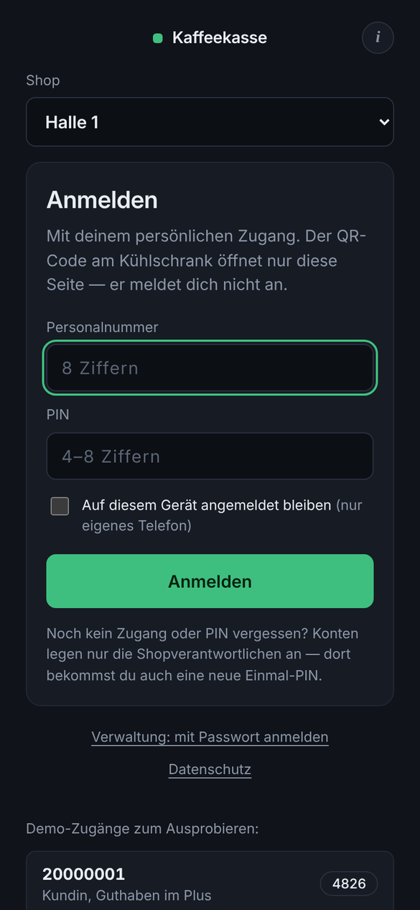 | 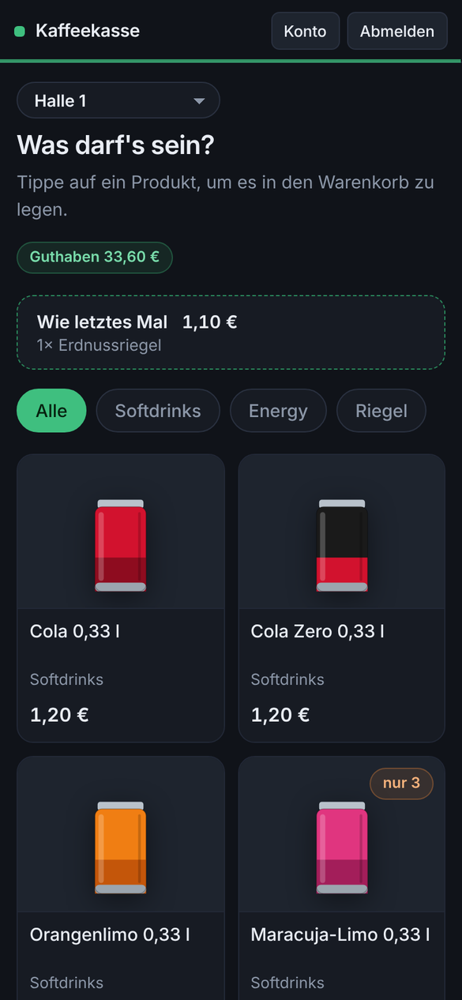 | 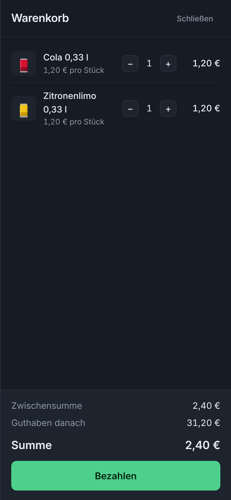 |

### Verwaltung

| Übersicht | Verkäufe |
|:---:|:---:|
| 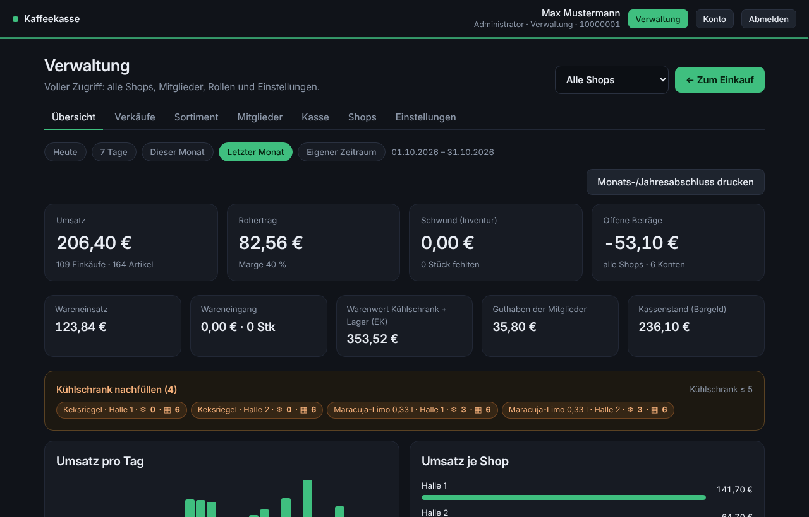 | 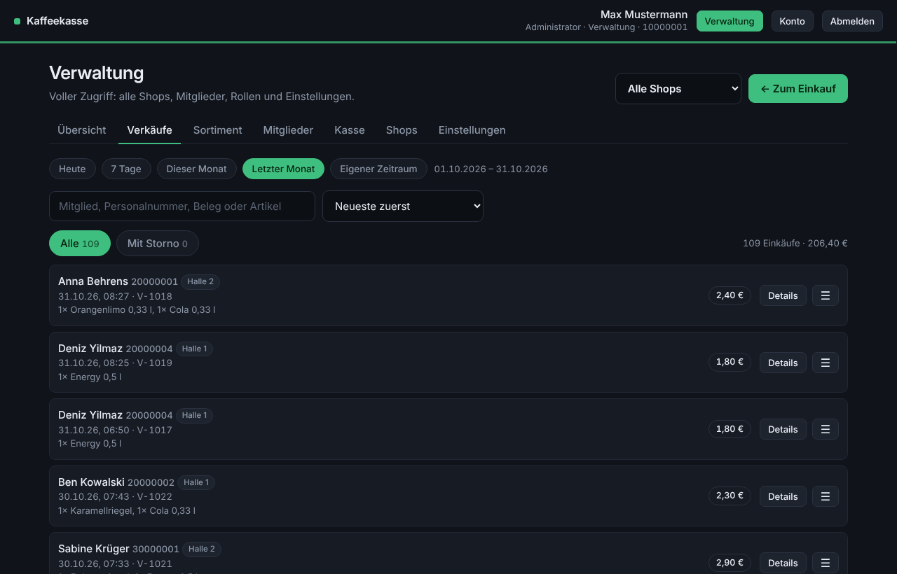 |
| **Sortiment** (Kühlschrank / Lager je Shop) | **Bestellvorschlag** |
| 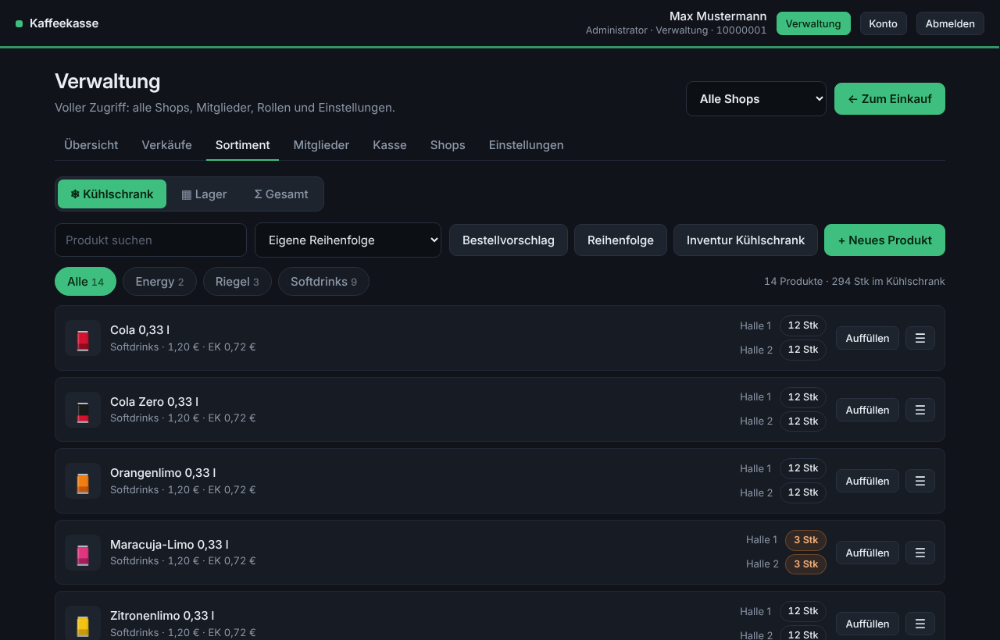 | 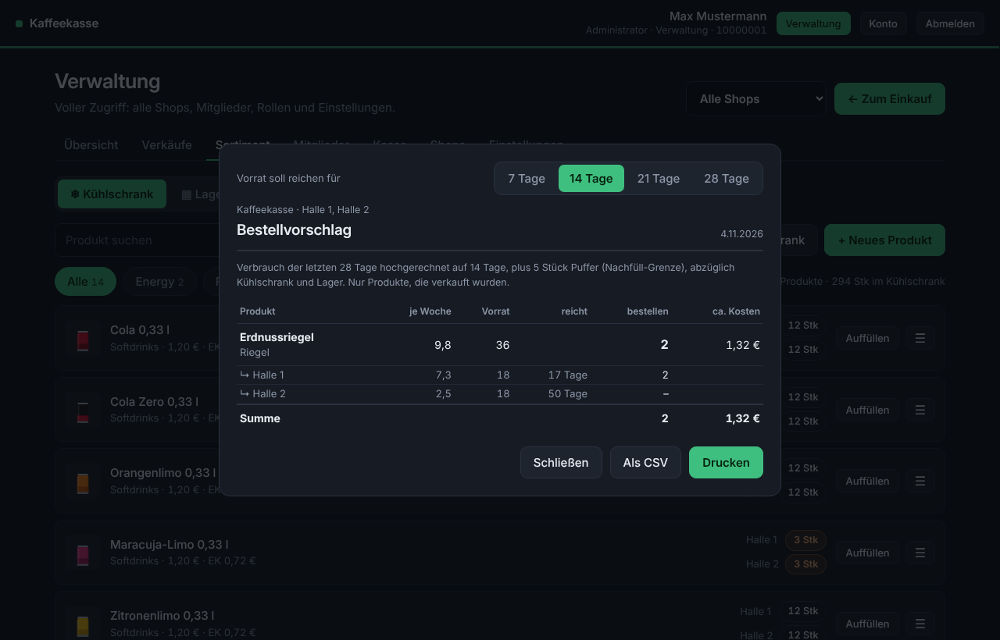 |
| **Mitglieder** | **Kasse** (Bargeld) |
| 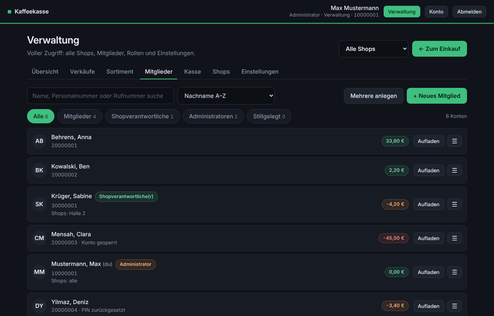 | 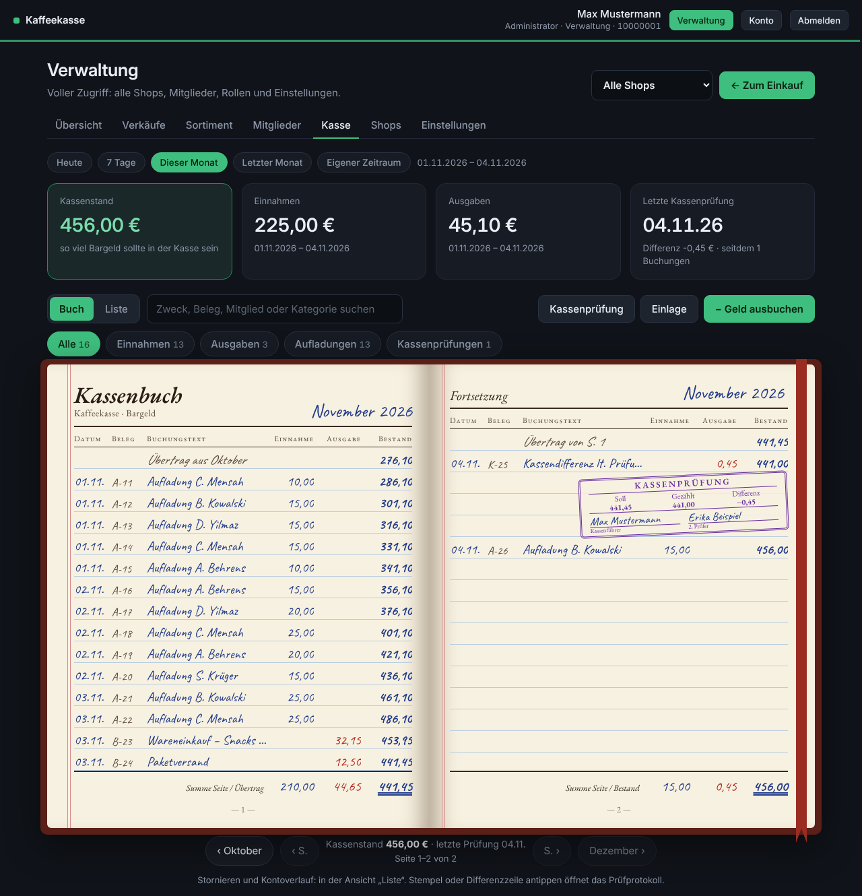 |
| **Monatsabschluss** zum Drucken | **Shops** |
| 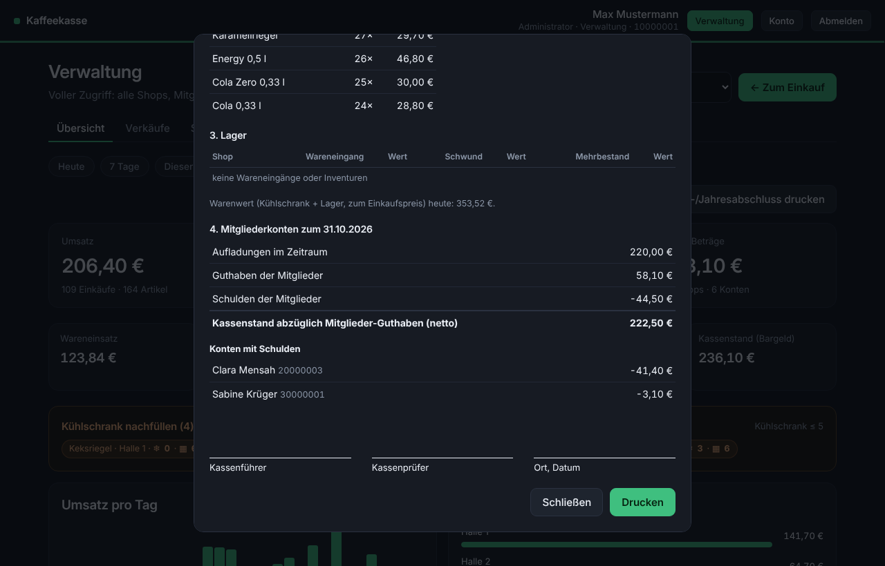 | 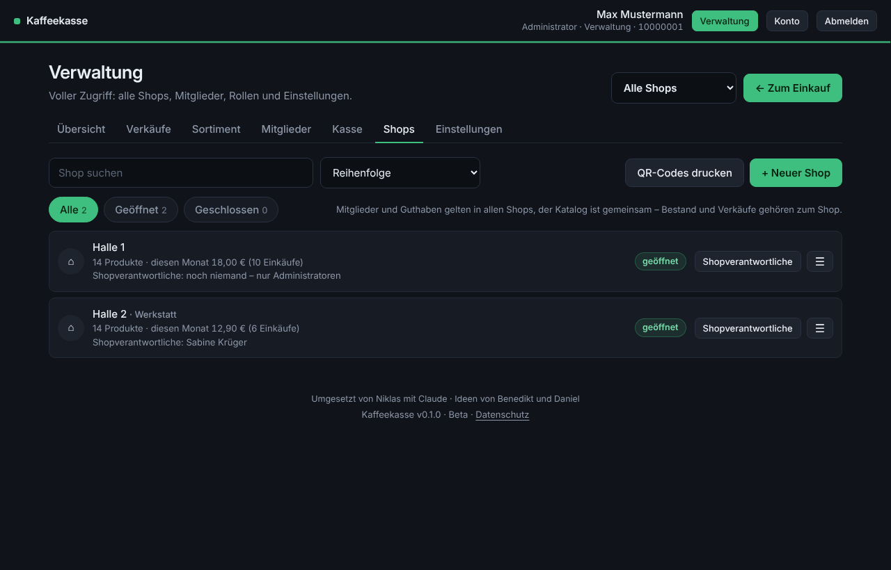 |

---

## Schnellstart

Voraussetzung: ein Rechner oder Server mit Docker und Docker Compose.

```bash
git clone https://github.com/TWIX99b/kaffeekasse.git
cd kaffeekasse
cp .env.example .env        # persönliche Einstellungen eintragen
nano .env
docker compose up -d --build
```

Dann im Browser `http://<server-ip>:8080` öffnen.

**Ersteinrichtung:** Beim allerersten Aufruf erscheint die Seite **Einrichtung**. Dort trägst du den Namen der Kaffeekasse und des ersten Shops (z. B. „Halle 1“) ein und legst den **Administrator** an: Vorname, Nachname, Personalnummer, Passwort (Verwaltung) und PIN (Einkauf). Das geht genau einmal – einen Standard-Zugang gibt es nicht.
Ein Beispiel-Katalog ist schon angelegt, alle Bestände stehen auf 0. Die echte Ware kommt über **Wareneingang** oder **Inventur** dazu.

> Ist die Kaffeekasse schon im Netz erreichbar, bevor du sie eingerichtet hast, setze in der `.env` einen `EINRICHTUNGS_CODE`. Sonst könnte sich jemand anderes zuerst als Administrator eintragen.

**Nur ausprobieren?** Vor dem ersten Start `DEMO=true` in die `.env` schreiben: Dann gibt es Beispielkonten und Demo-Knöpfe auf der Anmeldeseite. Im echten Betrieb bleibt das auf `false`.

**Fertiges Image statt selbst bauen:** In der `.env` `KAFFEEKASSE_IMAGE=ghcr.io/TWIX99b/kaffeekasse` eintragen, dann `docker compose pull && docker compose up -d`. Die Images gibt es für `amd64` und `arm64` (z. B. Raspberry Pi).

---

## Konfiguration (.env)

Alle persönlichen Werte stehen in der `.env` (Vorlage: `.env.example`), nicht in der `docker-compose.yml`. Die `.env` bleibt auf deinem Server und wird nicht ins Repository hochgeladen – so überschreiben Updates nichts.
Werte mit „Startwert“ gelten nur beim ersten Start und werden danach in der App unter **Einstellungen** geändert.

| Variable | Standard | Bedeutung |
|---|---|---|
| `PORT` | `8080` | Port auf dem Server |
| `ADRESSE` | `http://kaffeekasse.lokal:8080` | Adresse für Zugangszettel und QR-Codes (Startwert) |
| `PROXY_ANZAHL` | `0` | Anzahl Reverse Proxys davor (Nginx Proxy Manager, Traefik, Caddy …). Hinter einem Proxy: `1` |
| `EINRICHTUNGS_CODE` | leer | Code, der bei der Ersteinrichtung eingegeben werden muss |
| `SHOP_NAME` | `Kaffeekasse` | Name der Kaffeekasse (Startwert) |
| `ERSTER_SHOP` | `Halle 1` | Name des ersten Shops |
| `LIMIT_EUR` | `30` | Schuldengrenze: ab diesem Minus ist kein Einkauf mehr möglich (Startwert) |
| `MIN_BESTAND` | `5` | Nachfüll-Grenze im Kühlschrank (Startwert) |
| `WARN_GUTHABEN_EUR` | `5` | Hinweis im Einkauf unter diesem Guthaben, `0` = aus (Startwert) |
| `DATENSCHUTZ_KONTAKT` | leer | Ansprechpartner im Datenschutzhinweis (Startwert) |
| `STIL` | `standard` | Design: `standard`, `hangar` oder `dashboard` (Startwert) |
| `AUTO_LOGOUT_SECONDS` | `300` | Automatische Abmeldung beim Einkauf (Startwert) |
| `AUTO_LOGOUT_TEAM_SECONDS` | `900` | Automatische Abmeldung in der Verwaltung (Startwert) |
| `MAX_BUCHUNG_EUR` | `500` | Größte einzelne Aufladung, Abbuchung oder Startguthaben |
| `LOGIN_SPERRE_IP` | `30` | Fehlversuche je IP in 15 Minuten, danach 15 Minuten Pause (`0` = aus) |
| `COOKIE_SECURE` | `auto` | `auto` = Secure-Cookie nur bei HTTPS |
| `DEMO` | `false` | Beispielkonten und Demo-Knöpfe (nur vor dem ersten Start) |
| `BACKUP_UHR` / `BACKUP_TAGE` | `03:00` / `14` | Sicherungen innerhalb der App (`0` = aus) |
| `SICHERUNG_ORDNER` | `./sicherungen` | Zielordner des Sicherungs-Containers, z. B. ein NAS |
| `SICHERUNG_UHR` | `02:30` | Uhrzeiten der automatischen Sicherung, mehrere mit Komma |
| `SICHERUNG_ANZAHL` | `30` | So viele automatische Sicherungen bleiben liegen |
| `SICHERUNG_MELDE_URL` | leer | ntfy-/Gotify-Adresse, meldet nur Fehler der Sicherung |
| `KAFFEEKASSE_IMAGE` / `KAFFEEKASSE_TAG` | lokal / `latest` | Image von GitHub und gewünschte Version (siehe [Update](#update)) |
| `TZ` | `Europe/Berlin` | Zeitzone |

Seltener gebraucht, direkt in der `docker-compose.yml`: `COOKIE_NAME` (Name des Anmelde-Cookies, Standard `kaffeekasse_sitzung`) und `SECRET_KEY` (sonst wird ein Schlüssel erzeugt und in `/data/.secret_key` abgelegt).

---

## Rollen und Anmeldung

| Rolle | Mit PIN | Mit Passwort |
|---|---|---|
| **Mitglied** | in jedem Shop einkaufen, Kontoverlauf ansehen, PIN ändern, Design wählen | – |
| **Shopverantwortliche(r)** | einkaufen wie ein Mitglied | Mitglieder und Guthaben (alle), dazu für die **zugeordneten Shops**: Übersicht, Verkäufe und Storno, Wareneingang, Inventur, Produkte anlegen und ändern, Bestellvorschlag, Abschluss, Export, Protokoll |
| **Administrator** | einkaufen | alles in allen Shops, dazu Produkte löschen, Shops anlegen, Shopverantwortliche zuordnen, Rollen vergeben, Einstellungen, Benachrichtigungen, Sicherungen herunterladen und einlesen, alles zurücksetzen |

- **PIN** (4–8 Ziffern) = Einkauf. **Passwort** (mindestens 10 Zeichen, nur Shopverantwortliche und Administratoren) = Einkauf und Verwaltung.
- Nach jeder Anmeldung steht der **Einkauf im Vordergrund**. Mit Passwort öffnet der Knopf **Verwaltung** den Verwaltungsbereich, **← Zum Einkauf** führt zurück.
- Neue Konten bekommen eine **Einmal-PIN** (bzw. ein Einmalpasswort), die beim ersten Anmelden innerhalb von 10 Minuten durch eine eigene ersetzt wird.

---

## Funktionen im Einzelnen

### Einkaufen

- **Shop wählen** ganz oben – das Gerät merkt sich die Wahl. Ein Tablet in Halle 2 bleibt also auf Halle 2. Über den QR-Code am Kühlschrank landet man direkt im richtigen Shop.
- Produkte antippen, **Warenkorb** prüfen, **Bezahlen**. Leere Produkte bleiben ausgegraut sichtbar, bei wenig Bestand steht „nur noch 3“.
- **Wie letztes Mal:** Über den Produkten steht der letzte Einkauf in diesem Shop. Ein Tipp legt ihn in den Warenkorb – nur noch „Bezahlen“. Was gerade nicht im Kühlschrank ist, wird ausgelassen.
- **Hinweis bei niedrigem Guthaben** (einstellbar), ein Warnhinweis im Minus und eine Sperre ab der **Schuldengrenze**.
- Nach dem Bezahlen: **Weiter einkaufen** oder **Schließen** (schließt die App, die Anmeldung bleibt bis zur automatischen Abmeldung bestehen).

### Mehrere Shops

- **Ein gemeinsamer Katalog:** Jedes Produkt gibt es einmal – mit Namen, Preis und Bild für alle Shops.
- **Bestand und Verkäufe je Shop.** Unter Sortiment legt man fest, ob ein Produkt in einem Shop **geführt** wird.
- **Mitglieder, Guthaben und PINs gelten überall.**
- Der **Administrator** legt Shops an (auf Wunsch mit dem Sortiment eines anderen Shops, Bestand startet bei 0), schließt und löscht sie (nur solange dort nichts verkauft wurde) und ordnet die **Shopverantwortlichen** zu.
- **QR-Codes zum Aushängen:** Unter Shops → „QR-Codes drucken“ entsteht je Shop ein Aushang (etwa A6, vier pro A4-Blatt, mit Schnittlinien). Die QR-Codes erzeugt die Kaffeekasse selbst.
- Oben rechts in der Verwaltung wählt man den Shop für Übersicht, Verkäufe, Sortiment und Export – einen bestimmten oder „Alle Shops“.

### Verwaltung

Alle Listen funktionieren gleich: oben **Suche**, **Sortierung** und **+ Neu**, darunter **Filter** mit Anzahl. Jede Zeile hat **eine Hauptaktion** und ein **☰-Menü** mit allem Weiteren. Übersicht, Verkäufe, Kasse, Export und Protokoll haben eine **Zeitraum-Leiste**: Heute · 7 Tage · Dieser Monat · Letzter Monat · Eigener Zeitraum.

**Übersicht** – Umsatz, Rohertrag mit Marge, Schwund aus der Inventur, offene Beträge, Wareneinsatz, Wareneingang, Warenwert, Guthaben der Mitglieder, Kassenstand. Dazu „Kühlschrank nachfüllen“ (ein Klick öffnet Auffüllen bzw. Wareneingang), Umsatz pro Tag, je Shop, Meistverkauft und nach Kategorie.

**Monats- und Jahresabschluss** (Knopf in der Übersicht) – ein Bericht zum Ausdrucken mit Kasse (Anfangs- und Endbestand, alle Bewegungen, Kassenprüfungen), Verkäufen je Shop mit Stornos und Rohertrag, Meistverkauft, Wareneingang und Schwund sowie **Guthaben und Schulden der Mitglieder zum Stichtag** inklusive Liste der Konten mit Schulden. Unten Unterschriftsfelder für Kassenführer und Kassenprüfer.

**Verkäufe** – alle Einkäufe im Zeitraum. Einzelne Posten oder ganze Einkäufe **stornieren**: Das Geld geht zurück aufs Konto, die Ware zurück in den Kühlschrank des Shops. Anzahl und Summe rechnet der Server über alle Einkäufe im Zeitraum; angezeigt werden die neuesten 2000.

**Sortiment** – der Katalog mit dem Bestand je Shop, getrennt nach **❄ Kühlschrank** (daraus wird verkauft) und **▦ Lager** (Vorrat im Lagerraum).
- **Ablauf:** neue Ware → **Wareneingang** (meist ins Lager, mit Einkaufspreis je Stück) → **Auffüllen** (Lager → Kühlschrank) → Verkauf und Storno laufen über den Kühlschrank. Wird Platz gebraucht: ☰ → **Ins Lager zurücklegen** (Kühlschrank → Lager).
- **Inventur** getrennt für Kühlschrank und Lager; Abweichungen werden als Schwund bzw. Mehrbestand gebucht.
- **Bestellvorschlag:** rechnet aus dem Verbrauch der letzten 28 Tage hoch, was für die nächsten 7/14/21/28 Tage fehlt – plus die Nachfüll-Grenze als Puffer, abzüglich Kühlschrank und Lager. Je Shop und gesamt, mit geschätzten Kosten; drucken oder als CSV.
- **Eigene Reihenfolge je Shop** (ziehen oder mit ↑/↓), so wie die Produkte im Kühlschrank stehen.
- Wareneingang, Auffüllen, Zurücklegen und Inventur stehen im **Lagerbuch** (☰ → Lagerbewegungen); Verkäufe und Stornos stehen unter **Verkäufe**.
- Als Bild dient eine gezeichnete Dose oder ein Riegel; ein eigenes Foto ersetzt die Zeichnung (PNG/WebP mit Transparenz bleiben transparent).

**Mitglieder** – alle Konten mit Nachname, Vorname, Personalnummer, interner Rufnummer und Guthaben. Hauptaktion **Aufladen**, im ☰-Menü: Abbuchen, Kontoverlauf, Konto bearbeiten (inklusive PIN/Passwort zurücksetzen), Rolle ändern, zuständige Shops, Stilllegen, Löschen.
- **Mehrere anlegen:** Tabelle zum Ausfüllen oder direkt aus Excel einfügen bzw. CSV laden (bis 500 auf einmal). Fehler werden sofort markiert, angelegt wird erst, wenn alles stimmt. Danach Zugangszettel mit den Einmal-PINs drucken.
- **Stilllegen** (z. B. bei Versetzung): Das Konto kann sich nicht mehr anmelden, bleibt aber mit Personalnummer, PIN, Guthaben und Verlauf erhalten. Ein Restguthaben kann dabei bar ausgezahlt werden. „Reaktivieren“ macht es wieder nutzbar.
- **Löschen:** Käufe und Buchungen bleiben für die Abrechnung erhalten, ein Restsaldo wird ausgebucht, die Personalnummer wird frei.

**Kasse** (Bargeld, eine gemeinsame Kasse für alle Shops)
- **Kassenstand** – so viel Bargeld sollte in der Kasse sein. **Kassenbuch** mit laufendem Stand nach jeder Buchung – wahlweise als **Buch** (liniertes Papier, Handschrift, Übertrag je Seite, Prüfstempel, auf dem Handy eine Seite zum Blättern) oder als **Liste** mit Suche, Sortierung und Storno.
- **Jede Aufladung ist Bargeld** und erhöht den Kassenstand. Beim Abbuchen entscheidet ein Haken, ob Geld bar ausgezahlt wurde oder es nur eine Korrektur ist.
- **Geld ausbuchen** (Wareneinkauf, Versand, Event …) mit Zweck und Beleg-Nr., **Einlage** für Geld, das kein Guthaben ist (Spende, Anfangsbestand).
- Fehlbuchungen storniert ein Administrator per Gegenbuchung – im Kassenbuch wird nie etwas gelöscht.
- **Kassenprüfung** mit Zählhilfe (500 € … 1 ct), zweitem Prüfer und Bemerkung. Die Differenz kann gebucht werden, danach stimmt der Kassenstand wieder. Jede Prüfung ergibt ein **Protokoll** zum Ausdrucken.

**Einstellungen** (Administrator)
- *Allgemein:* Name, Schuldengrenze, automatische Abmeldung, Nachfüll-Grenze, Adresse für Zugangszettel, Hinweis bei niedrigem Guthaben, **Design**, Ansprechpartner für den Datenschutzhinweis.
- *Benachrichtigungen:* Webhook für „Kühlschrank nachfüllen“.
- *Export:* CSV-Dateien für Verkäufe (mit Einkaufspreis und Rohertrag), Kassenbuch, Kontobuchungen, Lagerbuch, Bestand mit Warenwert, Kontostände, Protokoll. Exporte sind gegen Excel-Formeln („CSV-Injection“) entschärft.
- *Sicherung & Daten:* Sicherungen auf dem Server, herunterladen, einlesen, Datenbank-Übersicht, alles zurücksetzen.
- *Protokoll:* jede Änderung mit Name und Uhrzeit, aus der App nicht löschbar.

---

## Designs

Der Administrator wählt unter **Einstellungen → Allgemein → Design der Kaffeekasse** das Aussehen für alle Geräte – beim Auswählen sofort als Vorschau. Hell oder dunkel wählt jede Person selbst unter **Konto → Design** (automatisch nach Gerät oder fest).

| Standard | Hangar | Dashboard |
|:---:|:---:|:---:|
|  | 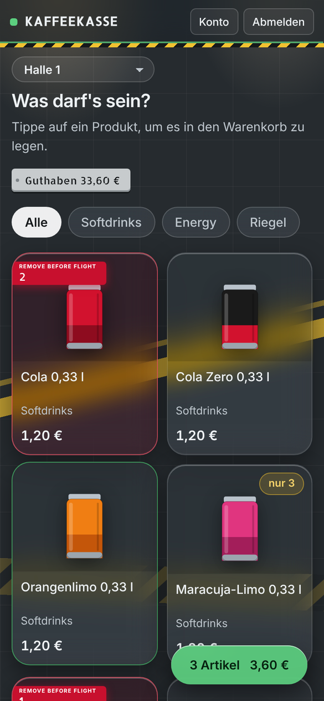 | 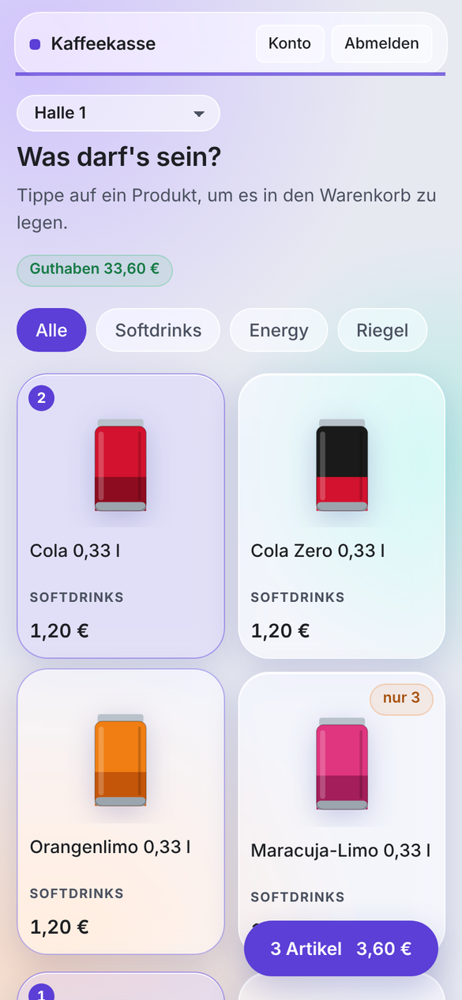 |
| schlicht, hell oder dunkel | Hallenboden mit Bodenmarkierungen, Glasflächen und Warnstreifen; Guthaben als Typenschild, Produkte im Warenkorb tragen eine **Remove-Before-Flight**-Fahne. Immer dunkel. | Milchglas-Kacheln im Stil eines Home-Assistant-Dashboards, hell oder dunkel |

Ausdrucke (Abschluss, Kassenprüfung, Bestellvorschlag, Zugangszettel, QR-Codes) sind unabhängig vom Design immer schwarz auf weiß.

Weitere Designs lassen sich ergänzen: in `app.py` bei `STILE` eintragen und in `static/app.css` einen Block `[data-stil="…"]` anlegen – die vorhandenen dienen als Vorlage.

---

## Benachrichtigungen

Fällt ein Produkt im Kühlschrank auf die Nachfüll-Grenze, kommt **eine** Meldung (die nächste erst, wenn zwischendurch aufgefüllt wurde). Sie nennt auch den Lagerstand („Lager leer, bitte nachbestellen“). E-Mail gibt es bewusst nicht, stattdessen einen **Webhook** (Einstellungen → Benachrichtigungen):

| Format | Beispiel-Adresse |
|---|---|
| Text (ntfy) | `https://ntfy.sh/mein-geheimer-kanal` – Push aufs Handy mit der ntfy-App |
| Gotify | `http://<gotify-server>:<port>/message?token=<App-Token>` (Token unter **Apps → Create Application**, nicht der Client-Token) |
| JSON (Home Assistant) | `http://homeassistant.lokal:8123/api/webhook/kaffeekasse` – Daten als `{"titel", "text", "shop", "produkte": [{"name", "bestand", "lager"}]}` |

**Testmeldung senden** zeigt sofort, ob alles ankommt, und sonst die genaue Ursache. Hinweis: `localhost` meint im Container die Kaffeekasse selbst – für andere Dienste die IP-Adresse des Servers eintragen.

---

## Sicherungen

Es gibt zwei voneinander unabhängige Wege.

**1. Sicherungs-Container** (`sicherung`, empfohlen) – kopiert die komplette Datenbank mit Produktfotos in einen **eigenen Ordner außerhalb des Daten-Volumes**, z. B. auf ein NAS (`SICHERUNG_ORDNER`).
- Automatisch zu den Uhrzeiten in `SICHERUNG_UHR`, behalten werden die letzten `SICHERUNG_ANZAHL`. Manuelle Sicherungen und die vor dem Einspielen bleiben liegen.
- Jede Sicherung ist eine echte Momentaufnahme (SQLite-Sicherungsfunktion), wird auf Beschädigung geprüft und gepackt abgelegt. Die Kaffeekasse läuft währenddessen normal weiter.
- Optional meldet `SICHERUNG_MELDE_URL` (ntfy/Gotify) Fehler.

```bash
docker compose exec sicherung sicherung jetzt "vor Update"    # sofort sichern, mit Notiz
docker compose exec sicherung sicherung liste                 # alle Sicherungen
docker compose exec sicherung sicherung pruefen               # neueste prüfen (oder Dateiname)
docker compose exec -it sicherung sicherung einspielen kaffeekasse_2026-11-04_023000_auto.db.gz
```

**Einspielen** zeigt vorher, was in der Sicherung steckt und was jetzt in der Datenbank ist, und fragt nach (`EINSPIELEN` tippen, in Skripten `--ja`). Der aktuelle Stand wird vorher automatisch gesichert. Danach melden sich alle Geräte neu an. Die App muss dafür nicht angehalten werden. Eine `.db.gz` ist nach `gunzip` eine normale SQLite-Datei.

**2. Sicherungen in der App** – täglich um `BACKUP_UHR` eine JSON-Sicherung im Daten-Volume, unter **Einstellungen → Sicherung & Daten** herunterladbar und (als Administrator) wieder einlesbar. Vor jedem Einlesen und Zurücksetzen wird der aktuelle Stand zusätzlich gesichert. Sicherungen enthalten die PIN- und Passwort-Hashes und sind deshalb nur für Administratoren zugänglich.

---

## Update

**Mit Image von GitHub:**

```bash
docker compose exec sicherung sicherung jetzt "vor Update"
docker compose pull
docker compose up -d
```

**Aus dem Quellcode** (nach `git pull`): `docker compose up -d --build`.

Die Daten im Volume bleiben erhalten; nötige Umstellungen der Datenbank macht die App beim Start selbst. Die laufende Version steht unten in der Fußzeile. Wichtig: den **Ordnernamen** nicht ändern – Docker benennt das Daten-Volume danach.

`KAFFEEKASSE_TAG` in der `.env` legt fest, was `docker compose pull` holt:

| Tag | Bedeutung |
|---|---|
| `latest` | neueste veröffentlichte Version (Standard) |
| `v0.3` | bleibt bei 0.3, bekommt nur Fehlerkorrekturen (0.3.1, 0.3.2 …) |
| `v0.3.1` | genau diese Version |
| `beta` | neueste Beta inklusive Vorabversionen zum Testen (z. B. `v0.4.0-rc.1`) |

Versionen unter 1.0 sind **Beta**. Ältere Installationen werden beim Start automatisch übernommen: gleichnamige Produkte aus mehreren Shops werden zu einem Katalog-Produkt zusammengeführt, der bisherige Bestand zählt als Kühlschrank, ganz alte Installationen ohne Shops landen im ersten Shop.

---

## Sicherheit

- **PINs und Passwörter** nur als Hash. Einmal-PINs und -Passwörter werden genau einmal angezeigt. Zu leichte PINs wie 1111 oder 1234 werden abgelehnt.
- **Anmelde-Schutz:** nach 5 Fehlversuchen 15 Minuten Kontosperre, zusätzlich eine IP-Bremse (`LOGIN_SPERRE_IP`). Ob es eine Personalnummer gibt, lässt sich an der Antwort nicht erkennen.
- **Sitzungen liegen auf dem Server:** Abmelden, Zeitlimit, PIN-/Passwortänderung, Rollenwechsel, Stilllegen und Löschen beenden die Anmeldung sofort – auch auf anderen Geräten.
- **Vier-Augen-Prinzip:** Shopverantwortliche können ihr eigenes Guthaben nicht aufladen oder abbuchen. Einzelbuchungen sind auf `MAX_BUCHUNG_EUR` begrenzt. Alles steht mit Namen im Protokoll.
- **Der Server prüft** Preise, Bestände, Rechte und die Schuldengrenze, nicht der Browser. Beträge werden exakt in Cent gerechnet; mehr als zwei Nachkommastellen werden abgelehnt.
- **Automatische Abmeldung:** Einkauf nach 5 Minuten, Verwaltung nach 15 Minuten. „Angemeldet bleiben“ gilt nur beim Einkauf und höchstens 30 Tage.
- **Browser-Schutz:** Content-Security-Policy (nur eigene Skripte und Schriften), CSRF-Schutz, HttpOnly- und SameSite-Cookies, kein Einbetten in fremde Seiten, HSTS bei HTTPS.
- **Produktfotos:** Jedes Foto wird auf dem Server geprüft und neu erzeugt (nur JPG/PNG/WebP, höchstens 1024 px, Metadaten wie GPS werden entfernt, Pixel-Bomben abgelehnt). Ausgeliefert wird es nur als Bild in einer Sandbox – auch Fotos aus eingelesenen Sicherungen durchlaufen diese Prüfung.
- Der Container läuft **ohne Root-Rechte**.

**Empfehlungen für den Betrieb**

1. `EINRICHTUNGS_CODE` setzen, wenn die Kaffeekasse vor der Einrichtung erreichbar ist.
2. **Nicht direkt ins Internet stellen** – besser nur im internen Netz oder per VPN. Wenn doch: nur über einen Reverse Proxy mit HTTPS, dort **HTTP auf HTTPS umleiten** (z. B. „Force SSL“ im Nginx Proxy Manager) und in der `.env` `PROXY_ANZAHL=1` setzen. Erst dann sieht der Anmelde-Schutz die echten IP-Adressen und die App erkennt HTTPS.
3. Den Port dann nur für den Proxy freigeben (z. B. `"127.0.0.1:8080:8080"` in der `docker-compose.yml`).
4. Den Sicherungsordner auf ein anderes Gerät legen (NAS).

---

## Datenschutz

Auf der Anmeldeseite, unten auf jeder Seite und unter **Konto** gibt es einen **Datenschutzhinweis**: welche Daten gespeichert werden, wer sie sieht, wie lange und an wen man sich wendet. Den Ansprechpartner trägt der Administrator unter Einstellungen → Allgemein ein.

Gespeichert werden nur Daten, die für die Abrechnung nötig sind. Es gibt keine Werbung, keine Weitergabe und keine Verbindung zu fremden Diensten. Der Text ist eine Vorlage – bei dienstlicher oder gewerblicher Nutzung bitte mit dem zuständigen Datenschutzbeauftragten abstimmen.

---

## Als App aufs Handy

Auf der Anmeldeseite erklärt der **ⓘ-Knopf**, wie man die Kaffeekasse auf dem Handy speichert – passend zum Gerät. Über **HTTPS** lässt sie sich als richtige App installieren (iPhone: Teilen → „Zum Home-Bildschirm“, Android/Chrome: „App installieren“) und startet dann ohne Browserleiste direkt im gewählten Shop. Über reines http geht das nicht, das ist eine Vorgabe der Browser.

Die Seite passt ohne Zoomen auf Bildschirme ab 320 px Breite.

---

## Fehlerbehebung

| Problem | Lösung |
|---|---|
| „Sitzung abgelaufen – bitte Seite neu laden“ direkt beim Anmelden | Eine andere App auf demselben Server setzt ein gleichnamiges Cookie. Mit `COOKIE_NAME` einen anderen Namen wählen. |
| „Bitte neu anmelden“ direkt nach dem Anmelden | Der Browser verwirft das Cookie (z. B. Secure-Cookie über http). Die App schickt die Sitzung zusätzlich im Header `X-Sitzung` mit; hinter einem Proxy `PROXY_ANZAHL=1` setzen. |
| Gesperrt nach 5 Fehlversuchen | 15 Minuten warten oder die PIN von Shopverantwortlichen zurücksetzen lassen. |
| Benachrichtigung kommt nicht an | „Testmeldung senden“ zeigt die genaue Ursache. `localhost` im Container ist die Kaffeekasse selbst. |
| Sicherungsordner nicht beschreibbar | Auf dem Server `sudo chown -R 1000:1000 <Ordner>` (der Container läuft als Benutzer 1000). |
| Nach einem Update alte Ansicht | Die Seite lädt neue Versionen automatisch; notfalls einmal neu laden. |

---

## Entwicklung und Tests

```
kaffeekasse/
├── app.py                  Server (Flask): Schnittstelle, Datenbank, Berechnungen
├── qr.py                   QR-Code-Erzeugung ohne fremde Dienste
├── static/                 Oberfläche: index.html, app.js, app.css, Schriften, Symbole
├── sicherung/              zweiter Container: Sicherungs-Dienst
├── tests/                  Rechen-, Bild- und Sicherungstest
├── docs/screenshots/       Bilder für diese Anleitung
├── .github/workflows/      Tests und Image-Bau auf GitHub
├── docker-compose.yml      beide Container
└── .env.example            Vorlage für die persönlichen Einstellungen
```

Lokal ohne Docker (Python 3.12):

```bash
pip install -r requirements.txt
DATA_DIR=./data DEMO=true python app.py      # http://localhost:8080
```

**Tests** – sie brauchen nur Flask und arbeiten mit einer eigenen, leeren Datenbank:

```bash
python3 tests/rechentest.py .      # Einkauf, Storno, Kasse, Prüfung, Inventur, Abschluss, Stilllegen … und alle Summen nachrechnen
python3 tests/sicherungstest.py .  # Sicherung schreiben, während ununterbrochen eingekauft wird
python3 tests/bildtest.py .        # schadhafte Dateien als Produktbild (getarntes HTML, Pixel-Bombe, präparierte Sicherung)
```

Auf GitHub läuft der Rechentest vor jedem Image-Bau (`.github/workflows/images.yml`); schlägt er fehl, wird kein Image veröffentlicht. Ein Push auf `main` baut das Image `main`, ein Tag wie `v0.2.0` baut `v0.2.0`, `v0.2` und `latest`.

---

## Lizenz und Danksagung

**Lizenz:** [MIT](LICENSE) – Nutzen, Verändern und Weitergeben ist erlaubt, solange der Lizenzhinweis erhalten bleibt. Ohne Gewähr: Die Kaffeekasse ist ein Hobbyprojekt, für Fehler bei Beträgen wird nicht gehaftet.

Mitgelieferte Schriften: **Inter** (The Inter Project Authors), **Allerta Stencil** (Matt McInerney), **Caveat** (The Caveat Project Authors) und **EB Garamond** (The EB Garamond Project Authors), alle unter der SIL Open Font License 1.1 – Lizenztexte in `static/fonts`.

Umgesetzt von **Niklas** mit **Claude** · Ideen von **Benedikt** und **Daniel**.
